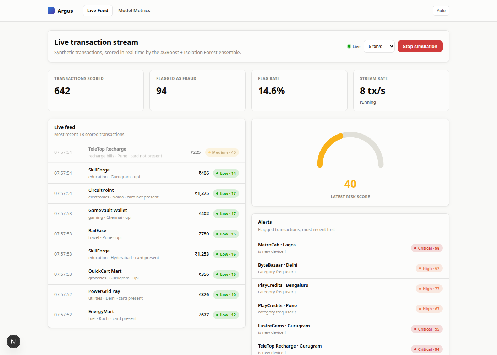
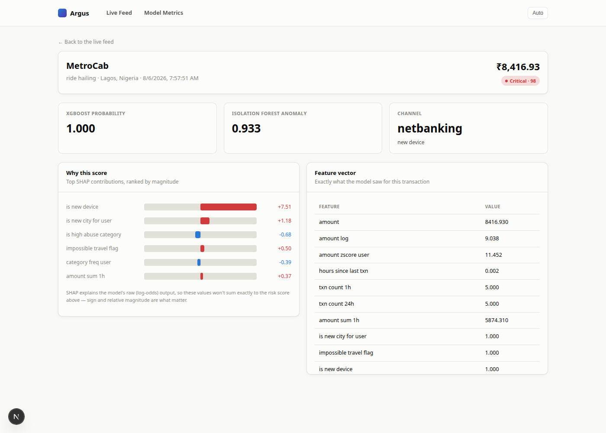
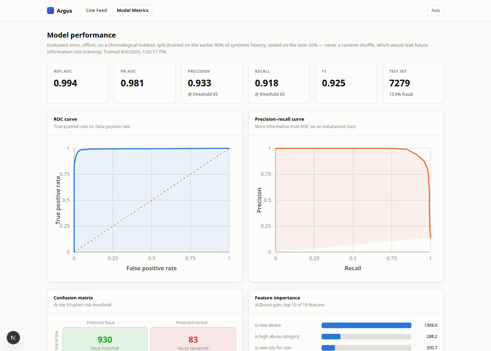
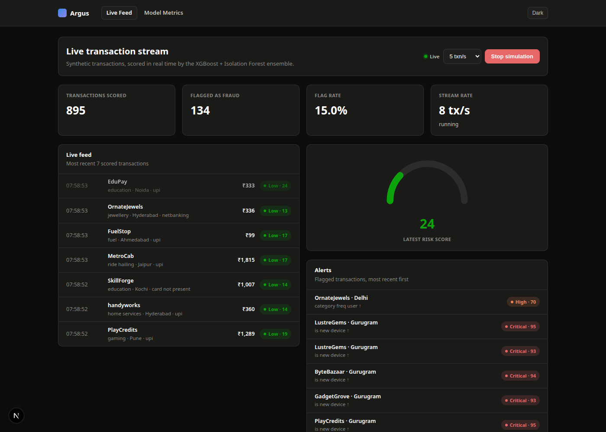
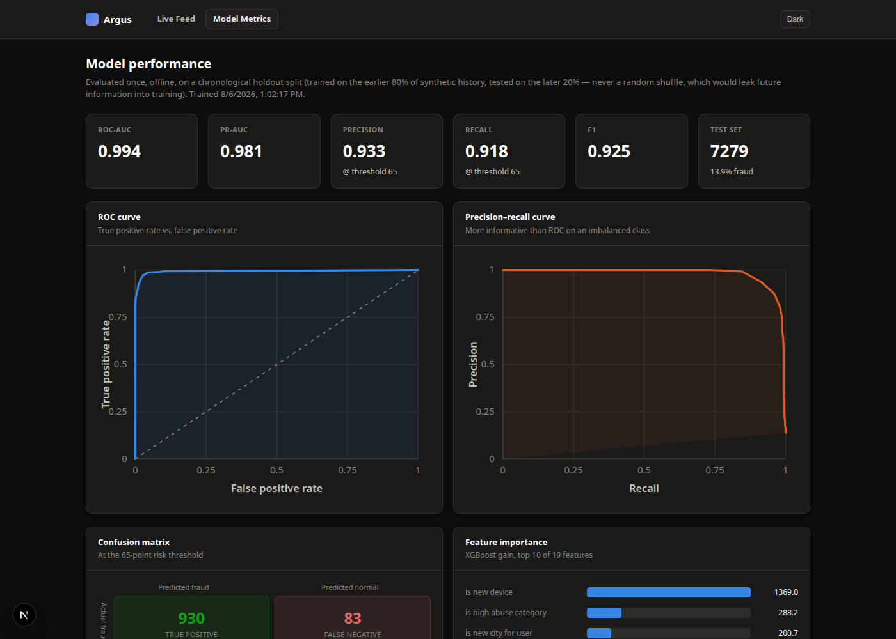

# Argus — Real-Time Fraud Detection Engine

A synthetic transaction stream, scored live by an XGBoost + Isolation Forest
ensemble, explained per-transaction with SHAP, and watched through a
real-time dashboard over WebSocket.

Built to be **demoable in an interview, not just readable**: click "Start
simulation" and watch transactions get scored and flagged in real time, drill
into any flagged one to see exactly which features drove the score, and check
the model's ROC/PR curves against a proper chronological holdout.



**[Live demo](#)** · **[API docs](#)** (FastAPI's `/docs`, once deployed)

## What this actually demonstrates

- **Causal feature engineering with train/serve parity.** `compute_features()`
  (`backend/app/features/engineering.py`) is called identically from offline
  training and online scoring — same function, same feature order, both
  paths. The only thing that differs is where `history` comes from (a
  DataFrame slice in training, a DB query online).
- **A hybrid ensemble, not just a classifier.** XGBoost (supervised, learns
  the labeled fraud patterns) + Isolation Forest (unsupervised, trained on
  mostly-normal data — catches anomaly shapes the supervised leg never saw
  labeled as fraud) combine into one 0–100 risk score.
- **A chronological holdout, not a random split.** Trained on the earlier 80%
  of synthetic history, evaluated on the later 20% — a random shuffle would
  leak future information into training, which is exactly the mistake that
  makes an offline fraud model's metrics lie about production performance.
- **Explainability that's actually wired into the product**, not a notebook
  cell — every flagged transaction has a live SHAP breakdown in the UI
  (`/transactions/[id]`), because "why was this flagged" is the first
  question a fraud analyst (or an interviewer) asks.
- **A live system, not a static report.** FastAPI background task generates
  transactions, scores them, persists them, and broadcasts them over
  WebSocket to however many dashboard tabs are open.

See [`docs/architecture.md`](docs/architecture.md) for the full data flow,
the five synthetic fraud scenarios, and the design decisions (and their
trade-offs) behind all of the above.

## Screenshots

| Live dashboard | Transaction explainability | Model performance |
|---|---|---|
|  |  |  |

Dark mode is a first-class target, not an afterthought:

| Dashboard (dark) | Metrics (dark) |
|---|---|
|  |  |

## Architecture

```
┌─────────────────┐      WebSocket       ┌──────────────────────┐
│   Next.js UI     │ ◄──────────────────► │   FastAPI backend     │
│  (dashboard,     │      REST (fetch)    │                       │
│   metrics,       │ ◄──────────────────► │  ┌─────────────────┐  │
│   drill-down)    │                       │  │ Simulation       │  │
└─────────────────┘                       │  │ engine (asyncio) │  │
                                            │  └────────┬────────┘  │
                                            │           │           │
                                            │  ┌────────▼────────┐  │
                                            │  │ Feature          │  │
                                            │  │ engineering      │  │
                                            │  │ (causal, shared  │  │
                                            │  │  train/serve)    │  │
                                            │  └────────┬────────┘  │
                                            │           │           │
                                            │  ┌────────▼────────┐  │
                                            │  │ XGBoost +        │  │
                                            │  │ Isolation Forest │  │
                                            │  │ + SHAP           │  │
                                            │  └────────┬────────┘  │
                                            │           │           │
                                            │  ┌────────▼────────┐  │
                                            │  │ Postgres/SQLite  │  │
                                            │  └─────────────────┘  │
                                            └──────────────────────┘
```

## Tech stack

**Backend:** Python 3.12, FastAPI, SQLAlchemy 2.0, XGBoost, scikit-learn
(Isolation Forest), SHAP, pandas/numpy, Postgres (prod) / SQLite (dev),
pytest, ruff, mypy (strict), uv.

**Frontend:** Next.js 16 (App Router), TypeScript (strict), hand-rolled SVG
charts (no charting library), plain CSS with light/dark design tokens, no
UI framework.

**Infra:** Docker Compose (Postgres + backend), GitHub Actions CI (lint +
typecheck + train + test on every push).

## Quickstart

### Docker Compose (backend + Postgres)

```bash
docker compose up --build
# backend: http://localhost:8000  (docs at /docs)
```

Then run the frontend against it:

```bash
cd frontend
cp .env.local.example .env.local   # points at localhost:8000 by default
npm install
npm run dev
# http://localhost:3000
```

### Fully manual (SQLite, no Docker)

```bash
# backend
cd backend
uv sync
uv run python -m app.ml.train         # trains the ensemble, ~7s, writes app/ml/artifacts/
uv run uvicorn app.main:app --reload  # http://localhost:8000

# frontend, in another terminal
cd frontend
cp .env.local.example .env.local
npm install
npm run dev                            # http://localhost:3000
```

Open the dashboard, click **Start simulation**, and watch it go.

## Testing

```bash
cd backend
uv run pytest -q          # 52 tests: feature engineering, fraud scenarios,
                            # the scorer's separation guarantee, the API,
                            # the simulation engine
uv run ruff check .
uv run mypy app
```

```bash
cd frontend
npm run lint
npx tsc --noEmit
npm run build
```

CI (`.github/workflows/ci.yml`) runs all of the above on every push.

## Honest limitations

- **Synthetic fraud is more separable than real fraud.** The five scenarios
  (account takeover, impossible travel, card-testing burst, structuring,
  merchant-category anomaly) are deliberately learnable so the pipeline's
  correctness is checkable end to end — ROC-AUC ≈0.99 here says "the system
  works," not "deploy this at a bank." Real fraud rates are also
  <<1%, not the ~14% these scenarios produce once burst patterns are
  expanded to individual rows.
- **No auth on the dashboard or the simulation controls.** Single-demo-user
  scope, deliberately — same trade-off a lot of internal tools make.
- **No database migrations.** `Base.metadata.create_all()` on startup, not
  Alembic — appropriate for a single-service demo with no schema history to
  preserve; a real production service would want the latter.
- **SHAP explains the model's raw (log-odds) output**, not the calibrated
  0–100 risk score directly — standard practice for tree-model
  explainability, but worth knowing before reading too much into whether the
  numbers "add up."

## License

MIT — see [`LICENSE`](LICENSE).
